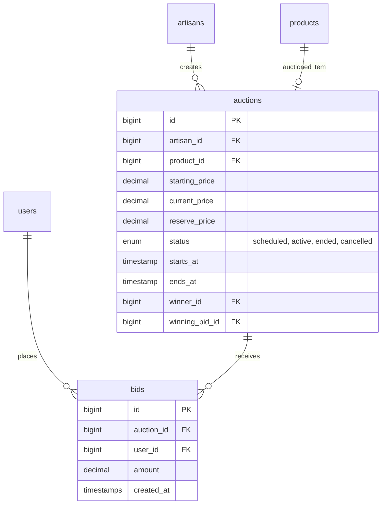
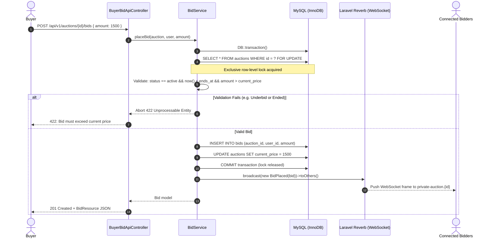
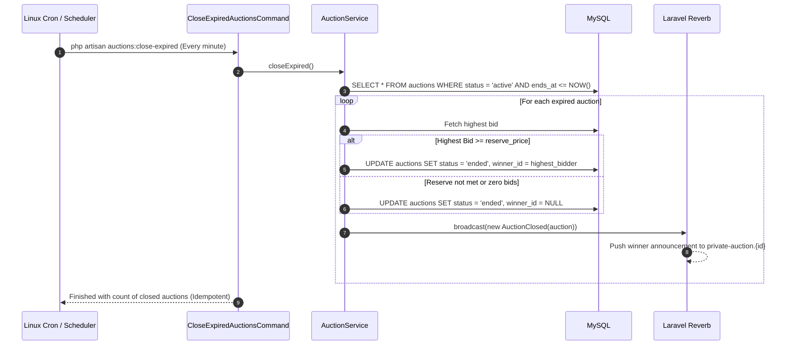

# Auction Module

> Real-time competitive bidding engine, time-window auction lifecycle management, and WebSocket broadcasting via Laravel Reverb. Status: `stable`

---

## 1. Overview

The **Auction Module** manages competitive bidding rooms for unique, handcrafted artisan items. It provides scheduled start/end windows, pessimistic database row-locking for bid concurrency, real-time WebSocket push updates, and automated background closing sweepers.

- **Who Uses It:**
  - **Guests / Public:** Browse active, scheduled, and past auctions with public bid history (reserve prices strictly hidden).
  - **Buyers:** Place bids on active auctions, monitor outbid events via WebSockets, view bid history.
  - **Artisans:** Create auctions (`starting_price`, confidential `reserve_price`, time window), monitor live bidding, cancel scheduled auctions.
- **What It Does NOT Do:**
  - It does **not** process final payment checkout (handled by [`Modules/Order`](../Order/README.md) once an auction ends with a winner).
  - It does **not** manage general fixed-price catalog listings (handled by [`Modules/Product`](../Product/README.md)).

---

## 2. Quick Start

### Required Environment Variables (`.env`)
```dotenv
BROADCAST_CONNECTION=reverb
REVERB_APP_ID=your-reverb-app-id
REVERB_APP_KEY=your-reverb-app-key
REVERB_APP_SECRET=your-reverb-app-secret
REVERB_HOST="ws.lamsa.ma"
REVERB_PORT=443
REVERB_SCHEME=https
```

### Migrations
- `create_auctions_table`
- `create_bids_table`

### Running Module Tests
```bash
php artisan test Modules/Auction/tests/Feature
```

---

## 3. Architecture

### Key File Structure
```
Modules/Auction/
├── app/
│   ├── Console/Commands/
│   │   └── CloseExpiredAuctionsCommand.php  # Scheduled sweeper: auctions:close-expired
│   ├── Enums/
│   │   └── AuctionStatus.php                # scheduled, active, ended, cancelled
│   ├── Events/
│   │   ├── BidPlaced.php                    # Broadcasts new bids to private-auction.{id}
│   │   └── AuctionClosed.php                # Broadcasts winner outcome to private-auction.{id}
│   ├── Http/
│   │   ├── Controllers/
│   │   │   ├── PublicAuctionApiController.php
│   │   │   ├── BuyerBidApiController.php
│   │   │   └── ArtisanAuctionApiController.php
│   │   ├── Requests/                        # StoreAuctionRequest, PlaceBidRequest, etc.
│   │   └── Resources/
│   │       ├── AuctionResource.php          # Public telemetry; shields reserve_price
│   │       └── BidResource.php
│   ├── Models/
│   │   ├── Auction.php
│   │   └── Bid.php
│   ├── Policies/
│   │   └── AuctionPolicy.php                # Artisan ownership and status authorization
│   ├── Providers/
│   │   └── AuctionModuleServiceProvider.php # Rate limiting, policies, routes & channels
│   └── Services/
│       ├── AuctionService.php               # CRUD, metrics, idempotent closeExpired()
│       └── BidService.php                   # lockForUpdate() bidding & concurrency
├── routes/
│   ├── api.php                              # REST endpoints (/api/v1/auctions/...)
│   └── channels.php                         # Broadcast channel auth: auction.{id}
└── tests/
    └── Feature/                             # Bidding, Broadcasting, and Sweeper tests
```

### Dependencies on Other Modules
- `Modules/Auth`: Depends on `User` and `Artisan` models for bidder and owner relationships.
- `Modules/Product`: Depends on `Product` and `Category` models for auction item relationships.

### Design Decisions (Why, Not Just What)
- **Pessimistic Concurrency (`lockForUpdate`):** In the final seconds of an auction ("bid sniping"), multiple buyers submit bids simultaneously. We acquire an exclusive MySQL row lock on the auction record inside a database transaction to serialize requests and prevent race conditions.
- **Instant Broadcast (`ShouldBroadcastNow`):** Instead of queuing WebSocket push jobs behind slow email jobs, `BidPlaced` dispatches synchronously to Laravel Reverb for sub-50ms fan-out.

---

## 4. Data Model



---

## 5. Core Flows

### A. Live Bidding & Real-Time WebSocket Push Flow



### B. Automated Sweeper & Winner Determination Flow



---

## 6. API Reference

### Public Endpoints

| Method | Endpoint | Query Filters | Description |
| :--- | :--- | :--- | :--- |
| `GET` | `/api/v1/auctions` | `status`, `category`, `search`, `sort`, `per_page` | Paginated public auction catalog. |
| `GET` | `/api/v1/auctions/{idOrSlug}` | None | Detailed view with bid history. `reserve_price` is strictly hidden. |

### Buyer Endpoints (`auth:sanctum`)

| Method | Endpoint | Rate Limit | Description |
| :--- | :--- | :--- | :--- |
| `POST` | `/api/v1/auctions/{auction}/bids` | `throttle:bidding` (30/min) | Places a bid under pessimistic row-locking. |
| `GET` | `/api/v1/buyer/bids` | None | Paginated history of bids placed by the user. |
| `DELETE`| `/api/v1/buyer/bids/{bid}` | None | Withdraw active bid (allowed only before auction closes). |

### Artisan Endpoints (`auth:sanctum`, `role:artisan`)

| Method | Endpoint | Form Request | Description |
| :--- | :--- | :--- | :--- |
| `GET` | `/api/v1/artisan/auctions` | None | List artisan's auctions with summary stats. |
| `POST` | `/api/v1/artisan/auctions` | `StoreAuctionRequest` | Create auction (`starting_price`, `reserve_price`, time window). |
| `PATCH`| `/api/v1/artisan/auctions/{auction}` | `UpdateAuctionRequest` | Update details before start (only when zero bids exist). |
| `DELETE`| `/api/v1/artisan/auctions/{auction}/cancel` | None | Cancels a scheduled or active auction. |

---

## 7. Events, Jobs & Commands

| Name | Type | Channel / Schedule | Purpose |
| :--- | :--- | :--- | :--- |
| `BidPlaced` | Broadcast Event | `private-auction.{id}` | Pushes new bid amount and bidder name in real-time. |
| `AuctionClosed` | Broadcast Event | `private-auction.{id}` | Pushes final winner name, amount, and reserve-met status. |
| `auctions:close-expired` | Artisan Command | `* * * * *` (Every min) | Sweeper evaluating expired auctions idempotently. |

---

## 8. Business Rules & Edge Cases

1. **Reserve Price Confidentiality:** The `reserve_price` column is confidential. Buyers must never see it in API JSON payloads; only the artisan owner can view it.
2. **Pessimistic Locking Concurrency:** All bids execute inside `DB::transaction()` using `lockForUpdate()`. Concurrent bids are queued by InnoDB; stale prices are rejected automatically.
3. **Idempotent Sweeper:** Running `auctions:close-expired` multiple times produces zero duplicate state changes or side effects.

---

## 9. Caching Strategy

- **Real-Time Read Isolation:** Live active auction endpoints do **not** use long-lived application caching to prevent serving stale prices during fast-paced bidding wars.
- **Cache-Control:** Bidding endpoints return `Cache-Control: no-cache, private`. Completed/historical auctions can be cached with `Cache-Control: public, max-age=3600`.

---

## 10. Testing & Quality

```bash
# Run all Auction feature tests (Bidding, Sweeper, Reverb auth)
php artisan test Modules/Auction/tests/Feature

# Inspect formatting
vendor/bin/pint --test Modules/Auction
```

---

## 11. Known Limitations & Roadmap

- **Automatic Bid Increments (Proxy Bidding):** Currently buyers place manual static bids. Max-bid auto-increment proxy bidding (eBay-style) is planned for Phase 2.
- **Automatic Anti-Sniping Extension:** Extending the auction timer by 2 minutes if a bid is placed in the final 60 seconds is in the development roadmap.
