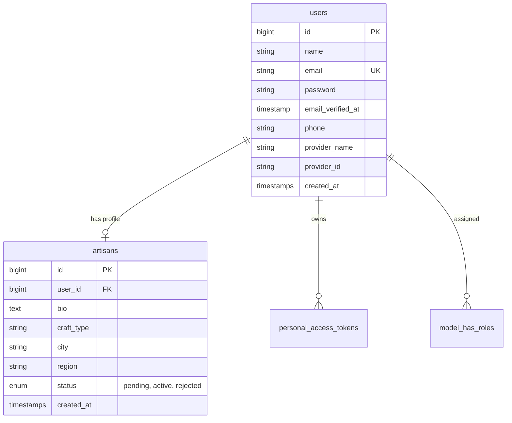
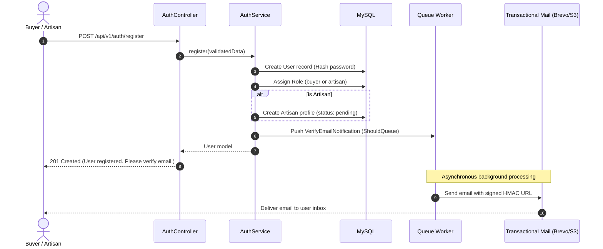
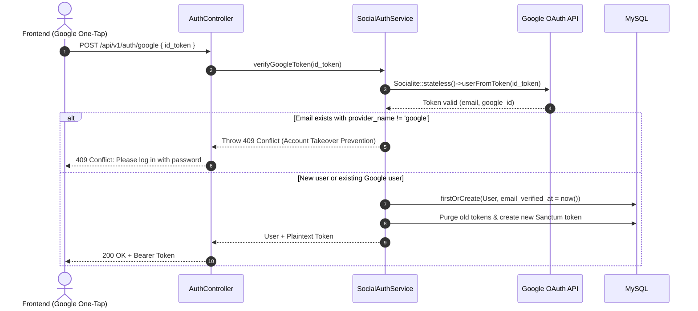

# Auth Module

> Stateless REST authentication, identity management, and role-based access control (RBAC) powered by Laravel Sanctum and Spatie. Status: `stable`

---

## 1. Overview

The **Auth Module** serves as the central identity gatekeeper for Lamsa.ma. It handles buyer and artisan registration, credential authentication, Google OAuth verification, email verification, and token lifecycle management.

- **Who Uses It:**
  - **Guests / Public:** Register as a buyer or artisan, log in via credentials or Google, verify email address.
  - **Authenticated Users (`buyer`, `artisan`, `admin`):** Inspect profile (`/me`), update profile/password, log out.
  - **Admins:** Review pending artisan onboarding applications.
- **What It Does NOT Do:**
  - It does **not** manage artisan store profiles, logos, or business settings (handled by [`Modules/Store`](../Store/README.md)).
  - It does **not** manage product creation or catalog browsing (handled by [`Modules/Product`](../Product/README.md)).

---

## 2. Quick Start

### Required Environment Variables (`.env`)
```dotenv
SANCTUM_EXPIRATION=10080

# Google OAuth
GOOGLE_CLIENT_ID=your-google-client-id.apps.googleusercontent.com
GOOGLE_CLIENT_SECRET=your-google-client-secret
GOOGLE_REDIRECT_URI="https://api.lamsa.ma/api/v1/auth/google/callback"

# Mail (Required for queued email verification)
MAIL_MAILER=smtp
MAIL_HOST=smtp-relay.brevo.com
MAIL_PORT=587
MAIL_USERNAME=your-user
MAIL_PASSWORD=your-key
MAIL_FROM_ADDRESS="no-reply@lamsa.ma"
MAIL_FROM_NAME="Lamsa"
```

### Database Migrations
Registered and loaded automatically via `AuthModuleServiceProvider`:
- `create_users_table`
- `create_artisans_table`
- `create_personal_access_tokens_table`
- `create_permission_tables` (Spatie)

### Running Module Tests
```bash
php artisan test Modules/Auth/tests/Feature
```

---

## 3. Architecture

### Key File Structure
```
Modules/Auth/
├── app/
│   ├── Events/
│   │   ├── UserRegistered.php            # Fired upon buyer/artisan creation
│   │   └── ArtisanProfileCreated.php     # Fired when artisan profile created (status: pending)
│   ├── Http/
│   │   ├── Controllers/
│   │   │   ├── AuthController.php        # Register, login, google, profile, logout
│   │   │   └── AdminArtisanApiController.php # Admin artisan approval/rejection
│   │   ├── Requests/                     # RegisterRequest, LoginRequest, GoogleLoginRequest, etc.
│   │   └── Resources/
│   │       └── UserResource.php          # Serializes user with roles & artisan profile
│   ├── Models/
│   │   ├── User.php                      # HasRoles, Notifiable, HasApiTokens
│   │   └── Artisan.php                   # Artisan profile (status: pending, active, rejected)
│   ├── Notifications/
│   │   └── VerifyEmailNotification.php   # ShouldQueue signed verification email
│   ├── Providers/
│   │   └── AuthModuleServiceProvider.php # Rate limiting & route loading
│   └── Services/
│       ├── AuthService.php               # Core registration, token policy, and credentials check
│       ├── SocialAuthService.php         # Google OAuth stateless token exchange
│       └── ProfileService.php            # User and artisan profile updates
└── routes/
    └── api.php                           # Route definitions under prefix api/v1/auth
```

### Dependencies on Other Modules
- **None (Root Module):** Auth sits at the base of the dependency tree. Other modules depend on `User` and `Artisan` models, but Auth never imports from `Product`, `Order`, or `Auction`.

### Design Decisions (Why, Not Just What)
- **Stateless Bearer Tokens (Sanctum):** Eliminates PHP session cookies, allowing mobile apps and headless frontends to authenticate identically via HTTP `Authorization: Bearer <token>`.
- **Single Active Session per Login:** During `login()`, `$user->tokens()->delete()` is invoked before creating a new token. This guarantees clean single-device sessions and immediately invalidates stolen or abandoned tokens.

---

## 4. Data Model



---

## 5. Core Flows

### A. Registration & Queued Email Verification Flow



### B. Google OAuth & Account Takeover Safeguard Flow



---

## 6. API Reference

### Public Routes (`throttle:auth`)

| Method | Endpoint | Form Request | Description |
| :--- | :--- | :--- | :--- |
| `POST` | `/api/v1/auth/register` | `RegisterRequest` | Registers buyer or artisan. Dispatches verification notification. |
| `POST` | `/api/v1/auth/login` | `LoginRequest` | Verifies credentials, blocks unverified users (403), issues Bearer token. |
| `POST` | `/api/v1/auth/google` | `GoogleLoginRequest` | Statelessly verifies Google ID token and issues token. |
| `GET` | `/api/v1/auth/email/verify/{id}/{hash}` | Signed URL | Validates HMAC signature and marks email as verified. |

### Protected Routes (`auth:sanctum`)

| Method | Endpoint | Form Request | Description |
| :--- | :--- | :--- | :--- |
| `GET` | `/api/v1/auth/me` | None | Returns authenticated user with roles and artisan relationship. |
| `PUT` | `/api/v1/auth/profile` | `UpdateProfileRequest` | Updates user profile attributes and artisan metadata. |
| `PUT` | `/api/v1/auth/password` | `UpdatePasswordRequest` | Updates user password with `Hash::make`. |
| `POST` | `/api/v1/auth/logout` | None | Revokes the current device token (`currentAccessToken()->delete()`). |
| `POST` | `/api/v1/auth/logout-all`| None | Revokes all active tokens across all devices. |

---

## 7. Events, Jobs & Commands

| Name | Type | Trigger | Payload |
| :--- | :--- | :--- | :--- |
| `UserRegistered` | Event | Dispatched immediately after user created | `User $user` |
| `ArtisanProfileCreated` | Event | Dispatched after pending artisan profile created | `Artisan $artisan` |
| `VerifyEmailNotification` | Queued Notification | Dispatched on registration & unverified login attempts | Signed HMAC verification URL |

---

## 8. Business Rules & Edge Cases

1. **Account Takeover Prevention:** If a user registered with password `user@example.com`, someone cannot sign in via Google using `user@example.com` unless account linking is confirmed. The system returns **`409 Conflict`**.
2. **2-Minute Verification Cooldown:** When an unverified user attempts to log in, instead of spamming emails on every failed attempt, the system sets `Cache::put('resend_cooldown:' . $user->id, true, 120)` to protect email deliverability.
3. **Signed URL Tamper Resistance:** Verification links are signed using Laravel's `URL::temporarySignedRoute()`. Tampering with the user ID or expiration parameter invalidates the HMAC signature and yields `403 Invalid Signature`.

---

## 9. Caching Strategy

- **Cooldown Locks:** `resend_cooldown:{user_id}` stored with 120s TTL to throttle email verification resends.
- **Cache-Control Headers:** All authenticated endpoints return `Cache-Control: no-cache, private` so upstream CDNs never cache private user data.

---

## 10. Testing & Quality

```bash
# Run all Auth feature tests
php artisan test Modules/Auth/tests/Feature

# Inspect formatting
vendor/bin/pint --test Modules/Auth
```

---

## 11. Known Limitations & Roadmap

- **Password Reset via SMS:** Currently password resets and verifications are email-only; SMS/WhatsApp verification is planned for Moroccan mobile numbers.
- **Multi-Factor Authentication (MFA):** TOTP/Authenticator app support planned for artisan payouts and admin access.
