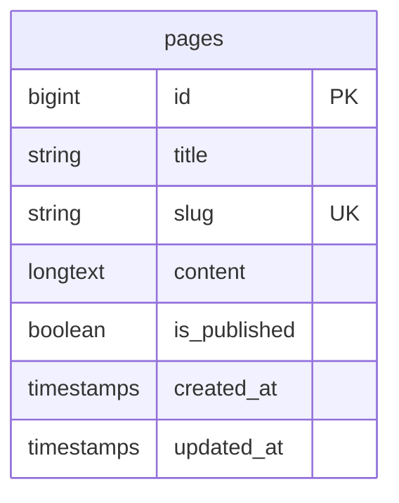

# CMS Module

> Headless, API-driven editorial content management for legal terms, informational pages, and navigation links. Status: `stable`

---

## 1. Overview

The **CMS (Content Management System) Module** provides a headless content delivery engine for Lamsa.ma. It manages static, informational, and legal documents (Terms of Service, Privacy Policy, About Us, FAQ, and Artisan Guidelines) while ensuring public consumers only receive safe, non-sensitive telemetry.

- **Who Uses It:**
  - **Guests / Public:** Fetch navigation/footer page lists (`/api/v1/pages`) and view published pages by slug (`/api/v1/pages/{slug}`).
  - **Admins:** Full CRUD management over page titles, markdown/HTML content, slugs, and publication states (`/api/v1/admin/pages`).
- **What It Does NOT Do:**
  - It does **not** manage catalog products, categories, or store descriptions (handled by [`Modules/Product`](../Product/README.md) and [`Modules/Store`](../Store/README.md)).
  - It does **not** manage complex page-builder layouts or UI widgets (it stores document content).

---

## 2. Quick Start

### Database Migrations
- `create_pages_table`

### Running Module Tests
```bash
php artisan test Modules/CMS/tests/Feature
```

---

## 3. Architecture

### Key File Structure
```
Modules/CMS/
├── app/
│   ├── Http/
│   │   ├── Controllers/
│   │   │   ├── PageController.php        # Public read-only endpoints (cached)
│   │   │   └── Admin/
│   │   │       └── PageController.php    # Admin CRUD management & slug generation
│   │   ├── Requests/Admin/               # StorePageRequest, UpdatePageRequest
│   │   └── Resources/
│   │       ├── PageListResource.php      # Lightweight: title and slug only
│   │       ├── PageDetailResource.php    # Public detail: title, slug, content, updated_at
│   │       └── Admin/
│   │           └── PageResource.php      # Full telemetry: id, timestamps, is_published
│   ├── Models/
│   │   └── Page.php                      # published() query scope
│   ├── Observers/
│   │   └── PageObserver.php              # Automated cache eviction on save/delete
│   └── Providers/
│       └── CMSModuleServiceProvider.php  # Observer registration & route loading
├── routes/
│   └── api.php                           # /api/v1/pages & /api/v1/admin/pages
└── tests/
    └── Feature/
        ├── AdminPageCrudTest.php
        └── PublicPageTest.php
```

### Dependencies on Other Modules
- `Modules/Auth`: Depends on `User` for admin authorization check (`$user->isAdmin()`).

### Design Decisions (Why, Not Just What)
- **Dual-Controller Architecture:** Administrative CRUD logic is strictly separated from public client consumption. This guarantees that admin modification logic never risks leaking draft data to public consumers.
- **Dedicated Public Resources & Data Minimization:** Public endpoints never expose auto-increment database IDs, draft flags, or creation timestamps.
- **Database Column Projection:** Public list queries execute `select(['id', 'title', 'slug'])`. This prevents MySQL from loading the heavy `content` column (`longtext` stored in off-page overflow storage) into PHP memory when simply building website footers.

---

## 4. Data Model



---

## 5. Core Flows

*(The CMS module is a direct document retrieval and editorial CRUD engine. No complex asynchronous multi-service flows are present).*

---

## 6. API Reference

### Public Endpoints (No Authentication Required)

| Method | Endpoint | Resource | Description |
| :--- | :--- | :--- | :--- |
| `GET` | `/api/v1/pages` | `PageListResource` | Returns published titles and slugs for website navigation. Cached. |
| `GET` | `/api/v1/pages/{slug}` | `PageDetailResource` | Returns title, slug, content, and `updated_at`. Returns 404 for drafts. |

### Admin Endpoints (`auth:sanctum`, `role:admin`)

| Method | Endpoint | Form Request | Description |
| :--- | :--- | :--- | :--- |
| `GET` | `/api/v1/admin/pages` | None | Paginated list of all pages (drafts and published). |
| `POST` | `/api/v1/admin/pages` | `StorePageRequest` | Create page. Auto-generates unique slug if omitted. |
| `GET` | `/api/v1/admin/pages/{page}` | None | View complete page record including drafts. |
| `PATCH`| `/api/v1/admin/pages/{page}` | `UpdatePageRequest` | Update title, content, slug, or publication status. |
| `DELETE`|`/api/v1/admin/pages/{page}` | None | Permanently delete page record. |

---

## 7. Events, Jobs & Commands

*N/A — Invalidation handled synchronously via `PageObserver`.*

---

## 8. Business Rules & Edge Cases

1. **Information Disclosure Prevention (Drafts return 404):** Requesting an unpublished draft via `/api/v1/pages/{slug}` returns `HTTP 404 Not Found` (never `403 Forbidden`). This prevents external attackers from probing for unreleased corporate policies or private announcements.
2. **Slug Collision Resolution:** If an admin leaves the slug empty or enters a duplicate, `generateUniqueSlug()` automatically appends incrementing numerical suffixes (`privacy-policy-1`, `privacy-policy-2`).
3. **Old Slug Invalidation on Rename:** If an admin updates `/pages/faq` to `/pages/help`, `PageObserver` detects the slug change via `$page->wasChanged('slug')` and purges **both** `cms_page_faq` and `cms_page_help` from cache.

---

## 9. Caching Strategy

- **Cache Keys:**
  - `cms_pages_list` (TTL: 86400s / 24 hours)
  - `cms_page_{slug}` (TTL: 86400s / 24 hours)
- **Automated Invalidation:** [`PageObserver`](app/Observers/PageObserver.php) clears `cms_pages_list` and the specific page slug cache whenever a page is saved, updated, or deleted.
- **Edge Cache-Control:** Public responses return `Cache-Control: public, max-age=3600, stale-while-revalidate=60`.

---

## 10. Testing & Quality

```bash
# Run all CMS feature tests (Admin CRUD, Public viewer, Caching)
php artisan test Modules/CMS/tests/Feature

# Inspect formatting
vendor/bin/pint --test Modules/CMS
```

---

## 11. Known Limitations & Roadmap

- **Multi-Lingual Content (i18n):** Currently pages store a single language string. Multi-lingual support (Arabic, French, English) via Spatie Translatable is scheduled for Phase 2.
- **Revision History & Rollbacks:** Adding an audit log of past content revisions for compliance auditing is on the roadmap.
