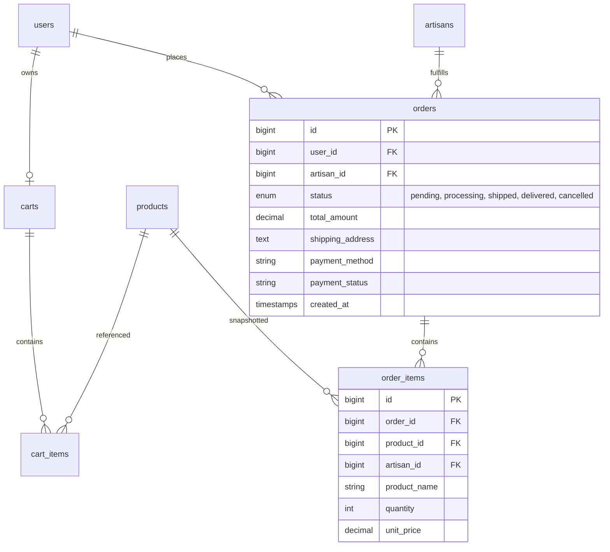
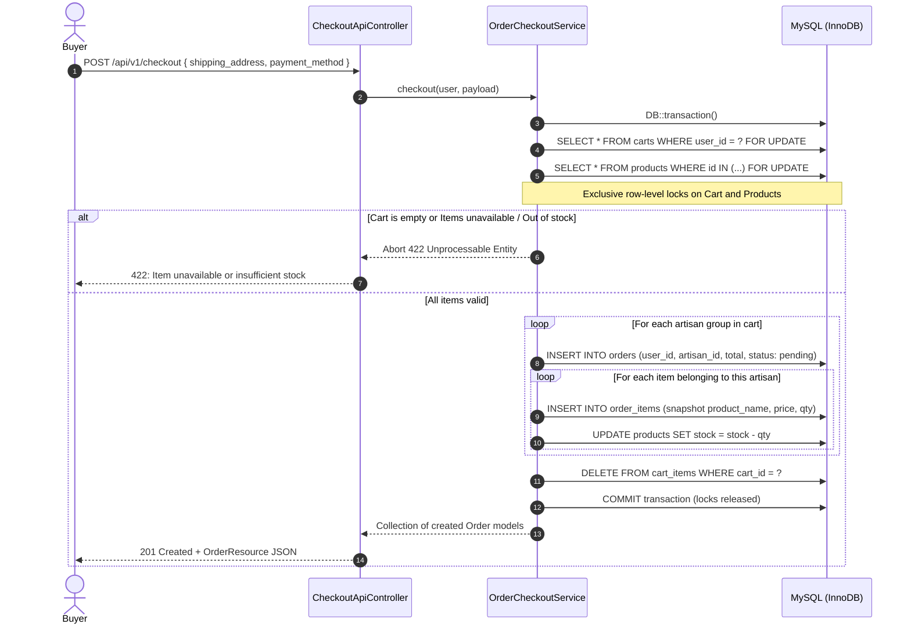

# Order Module

> Multi-vendor shopping cart, atomic checkout with pessimistic inventory locking, per-artisan sub-order splitting, and fulfillment state machine. Status: `stable`

---

## 1. Overview

The **Order Module** manages the core transactional commerce lifecycle for Lamsa.ma. It handles buyer shopping baskets, guest-to-authenticated cart synchronization, atomic multi-vendor checkout, and order fulfillment state machines for Moroccan artisans.

- **Who Uses It:**
  - **Buyers:** Add items to cart, synchronize guest baskets upon login, execute checkout, track and cancel pending orders.
  - **Artisans:** Inspect incoming orders for their handcrafted items, transition fulfillment status (`processing` $\rightarrow$ `shipped` $\rightarrow$ `delivered`).
  - **Admins:** Global order inspection and customer dispute management.
- **What It Does NOT Do:**
  - It does **not** manage general product catalog listings (handled by [`Modules/Product`](../Product/README.md)).
  - It does **not** manage live competitive auctions (handled by [`Modules/Auction`](../Auction/README.md)).

---

## 2. Quick Start

### Database Migrations
- `create_carts_table`
- `create_cart_items_table`
- `create_orders_table`
- `create_order_items_table`

### Running Module Tests
```bash
php artisan test Modules/Order/tests/Feature
```

---

## 3. Architecture

### Key File Structure
```
Modules/Order/
├── app/
│   ├── Enums/
│   │   ├── OrderStatus.php               # pending, processing, shipped, delivered, cancelled
│   │   └── PaymentStatus.php             # unpaid, paid, cash_on_delivery
│   ├── Http/
│   │   ├── Controllers/
│   │   │   ├── CartApiController.php     # Cart management & guest sync
│   │   │   ├── CheckoutApiController.php # Atomic checkout endpoint
│   │   │   ├── BuyerOrderApiController.php # Buyer order tracking & cancellation
│   │   │   └── ArtisanOrderApiController.php # Artisan fulfillment updates
│   │   ├── Requests/                     # CheckoutRequest, AddCartItemRequest, etc.
│   │   └── Resources/                    # CartResource, OrderResource, OrderItemResource
│   ├── Models/
│   │   ├── Cart.php
│   │   ├── CartItem.php
│   │   ├── Order.php
│   │   └── OrderItem.php                 # Price & product name snapshot record
│   ├── Policies/
│   │   └── OrderPolicy.php               # Buyer cancellation & artisan fulfillment gates
│   ├── Providers/
│   │   └── OrderModuleServiceProvider.php # Rate limiting & route definitions
│   └── Services/
│       ├── CartService.php               # Guest sync & basket management
│       ├── OrderCheckoutService.php      # lockForUpdate() inventory & order splitting
│       └── OrderService.php              # State machine transitions & stock restoration
└── routes/
    └── api.php                           # /api/v1/cart, /api/v1/checkout, /api/v1/orders
```

### Dependencies on Other Modules
- `Modules/Auth`: Depends on `User` (buyer) and `Artisan` (vendor).
- `Modules/Product`: Depends on `Product` (stock decrement, price check, category details).

### Design Decisions (Why, Not Just What)
- **Multi-Vendor Order Splitting:** In a Moroccan marketplace, an order containing pottery from Fez and leather from Marrakech cannot share a single shipment. Checkout automatically splits the cart by `artisan_id`, generating independent `Order` records for each vendor.
- **Pessimistic Row-Level Locking:** During checkout, `lockForUpdate()` locks both the buyer's `cart` and all purchased `products` rows inside a single database transaction. This makes double-spend inventory bugs mathematically impossible.
- **Immutable Historical Snapshots:** Products change prices and names over time. `order_items` stores historical snapshot columns (`product_name`, `unit_price`), ensuring accounting records never alter when an artisan modifies their catalog.

---

## 4. Data Model



---

## 5. Core Flows

### Atomic Checkout & Multi-Vendor Order Splitting Flow



---

## 6. API Reference

### Shopping Cart Endpoints (`auth:sanctum`)

| Method | Endpoint | Form Request | Description |
| :--- | :--- | :--- | :--- |
| `GET` | `/api/v1/cart` | None | Fetch user's cart items, totals, and live availability. |
| `POST` | `/api/v1/cart/items/{product}` | `AddCartItemRequest` | Add product to cart with requested quantity. |
| `PATCH`| `/api/v1/cart/items/{product}` | `UpdateCartItemRequest`| Update quantity of existing cart item. |
| `DELETE`|`/api/v1/cart/items/{product}` | None | Remove a specific product from cart. |
| `DELETE`|`/api/v1/cart` | None | Clears the shopping cart completely. |
| `POST` | `/api/v1/cart/sync` | `SyncCartRequest` | Merges unauthenticated guest items into the user's database cart. |

### Checkout Endpoint (`auth:sanctum`)

| Method | Endpoint | Rate Limit | Form Request | Description |
| :--- | :--- | :--- | :--- | :--- |
| `POST` | `/api/v1/checkout` | `throttle:checkout` (10/min) | `CheckoutRequest` | Atomic checkout with inventory lock & order splitting. |

### Order Tracking & Fulfillment Endpoints (`auth:sanctum`)

| Method | Endpoint | Role | Policy Gate | Description |
| :--- | :--- | :--- | :--- | :--- |
| `GET` | `/api/v1/buyer/orders` | Buyer | `viewAny` | Paginated listing of orders placed by user. |
| `GET` | `/api/v1/buyer/orders/{order}` | Buyer | `view` | View order details and delivery progress. |
| `POST`| `/api/v1/buyer/orders/{order}/cancel` | Buyer | `cancel` | Cancels pending order and restores stock. |
| `GET` | `/api/v1/artisan/orders` | Artisan | `artisan` role | List incoming customer orders for artisan. |
| `PATCH`|`/api/v1/artisan/orders/{order}/status` | Artisan | `updateStatus` | Updates status (`processing` $\rightarrow$ `shipped` $\rightarrow$ `delivered`). |

---

## 7. Events, Jobs & Commands

| Name | Type | Trigger | Purpose |
| :--- | :--- | :--- | :--- |
| `OrderCreated` | Event | Dispatched per sub-order on checkout | Triggers customer receipt & artisan notification |
| `OrderStatusUpdated` | Event | Dispatched when artisan updates status | Triggers tracking email/notification to buyer |

---

## 8. Business Rules & Edge Cases

1. **Concurrent Double-Checkout Immunity:** Locking the `carts` row serializes duplicate clicks on "Place Order". The second attempt finds the cart empty and aborts with `HTTP 422`.
2. **Soft-Deleted Product Resilience:** Order item relationships use `->withTrashed()`. An artisan soft-deleting an item after a sale never breaks invoices or buyer order cancellations.
3. **Automatic Stock Restoration on Cancellation:** When a buyer cancels a `pending` order, the system restores stock for all item rows via `increment('stock', $qty)`.

---

## 9. Caching Strategy

- **Transactional Bypassing:** Shopping carts and checkout bypass query cache to ensure 100% accurate, authoritative inventory levels and pricing.
- **Cache-Control:** All cart, checkout, and order endpoints return `Cache-Control: no-cache, private`.

---

## 10. Testing & Quality

```bash
# Run all Order feature tests (Cart, Checkout, Fulfillment, Stock restoration)
php artisan test Modules/Order/tests/Feature

# Inspect formatting
vendor/bin/pint --test Modules/Order
```

---

## 11. Known Limitations & Roadmap

- **Integrated Online Gateway:** Currently supports Cash on Delivery and manual credit card processing. Integration with CMI (Centre Monétique Interbancaire) or Stripe is scheduled for Phase 2.
- **Partial Item Returns:** Return requests are handled at the sub-order level; item-by-item partial refund workflows are in development.
