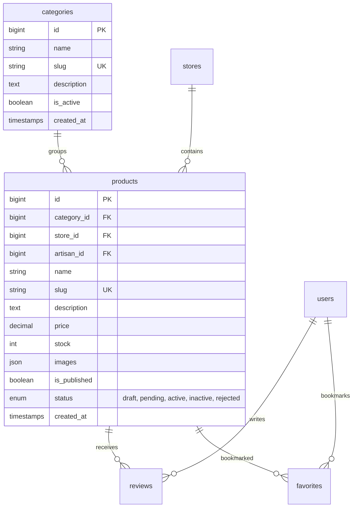

# Product Module

> Product catalog browsing, full-text search, category hierarchy, aggregated reviews, favorites wishlist, and category caching. Status: `stable`

---

## 1. Overview

The **Product Module** powers the core catalog and discovery experience on Lamsa.ma. It enables buyers to search, filter by price and category, inspect detailed product specifications with review summaries, and save items to their personal wishlist. It also empowers admins to manage category taxonomies.

- **Who Uses It:**
  - **Guests / Buyers:** Browse visible products, search keywords, filter by category/price, read reviews, toggle favorites (when authenticated).
  - **Artisans:** Link their handcrafted creations to product categories and stores.
  - **Admins:** Full CRUD operations on categories (`/api/v1/admin/categories`).
- **What It Does NOT Do:**
  - It does **not** manage shopping carts or order checkout transactions (handled by [`Modules/Order`](../Order/README.md)).
  - It does **not** manage live competitive auction rooms (handled by [`Modules/Auction`](../Auction/README.md)).

---

## 2. Quick Start

### Database Migrations
- `create_categories_table`
- `create_products_table`
- `create_reviews_table`
- `create_favorites_table`

### Running Module Tests
```bash
php artisan test Modules/Product/tests/Feature
```

---

## 3. Architecture

### Key File Structure
```
Modules/Product/
├── app/
│   ├── Enums/
│   │   └── ProductStatus.php             # draft, pending, active, inactive, rejected
│   ├── Http/
│   │   ├── Controllers/
│   │   │   ├── ProductCatalogController.php # Public search & detail
│   │   │   ├── CategoryController.php    # Public categories list
│   │   │   ├── FavoriteController.php    # Buyer wishlist management
│   │   │   ├── ReviewController.php      # Buyer product reviews
│   │   │   └── Admin/
│   │   │       └── CategoryController.php # Admin category CRUD
│   │   ├── Requests/                     # ProductCatalogRequest, StoreCategoryRequest, etc.
│   │   └── Resources/
│   │       ├── ProductCatalogResource.php # Lightweight list resource
│   │       ├── ProductDetailResource.php  # Detailed view with artisan & store telemetry
│   │       └── CategoryResource.php
│   ├── Models/
│   │   ├── Category.php
│   │   ├── Product.php
│   │   ├── Review.php
│   │   └── Favorite.php
│   ├── Observers/
│   │   ├── CategoryObserver.php          # Clears active_categories_list cache
│   │   └── ProductObserver.php           # Purges category count cache on product changes
│   ├── Providers/
│   │   └── ProductModuleServiceProvider.php # Observers, rate limiters, routes
│   └── Services/
│       └── ProductCatalogService.php     # Gateway service: scopes, filters, and caching
└── routes/
    └── api.php                           # /api/v1/products, /api/v1/categories, /api/v1/favorites
```

### Dependencies on Other Modules
- `Modules/Auth`: Depends on `User` (for reviews and favorites) and `Artisan` (for product creator).
- `Modules/Store`: Relates to `Store` model to associate products with artisan storefronts.

### Design Decisions (Why, Not Just What)
- **Gateway Service Pattern:** All catalog queries route through [`ProductCatalogService`](app/Services/ProductCatalogService.php). Controllers never query models directly for catalog listings. This guarantees that visibility rules (`scopeVisible()`) are applied authoritatively.
- **N+1 Avoidance via SQL Aggregation:** Instead of loading thousands of reviews per product or using expensive accessors, average ratings are computed via SQL aggregates (`withAvg('reviews', 'rating')` and `withCount('reviews')`).
- **Composite Indexing:** The `products` table has a composite index on `(is_published, status, deleted_at)` to accelerate filtered catalog queries.

---

## 4. Data Model



---

## 5. Core Flows

*(The Product module is primarily an optimized search, catalog retrieval, and review ingestion engine. No complex asynchronous multi-service state machines exist).*

---

## 6. API Reference

### Public Catalog Endpoints (`throttle:catalog`)

| Method | Endpoint | Query Parameters | Description |
| :--- | :--- | :--- | :--- |
| `GET` | `/api/v1/products` | `q`, `category`, `min_price`, `max_price`, `sort`, `per_page` | Paginated product search & catalog. |
| `GET` | `/api/v1/products/{product:slug}` | None | Detailed product view with artisan info and review summary. |
| `GET` | `/api/v1/categories` | None | Active category list with visible product count. Cached in Redis. |
| `GET` | `/api/v1/products/{product}/reviews` | `per_page` | Paginated reviews for a product. |

### Buyer Endpoints (`auth:sanctum`)

| Method | Endpoint | Form Request | Description |
| :--- | :--- | :--- | :--- |
| `POST` | `/api/v1/products/{product}/reviews` | `StoreReviewRequest` | Submit rating (1-5) and comment. Enforces one review per product. |
| `GET` | `/api/v1/favorites` | None | List buyer's bookmarked favorite products. |
| `POST` | `/api/v1/products/{product}/favorite`| None | Toggle wishlist status (bookmark/unbookmark). |

### Admin Endpoints (`auth:sanctum`, `role:admin`)

| Method | Endpoint | Form Request | Description |
| :--- | :--- | :--- | :--- |
| `GET` | `/api/v1/admin/categories` | None | Paginated list of all categories. |
| `POST` | `/api/v1/admin/categories` | `StoreCategoryRequest` | Create new category (auto-slug generated). |
| `PATCH`| `/api/v1/admin/categories/{category}`| `UpdateCategoryRequest`| Update category details or active flag. |
| `DELETE`|`/api/v1/admin/categories/{category}`| None | Deletes category. |

---

## 7. Events, Jobs & Commands

*N/A — Handled synchronously with observers.*

---

## 8. Business Rules & Edge Cases

1. **Strict Public Visibility Invariant:** Public catalog searches strictly filter out soft-deleted, unpublished (`is_published: false`), or non-active products (`status != 'active'`).
2. **Review Uniqueness:** A buyer can only review a given product once (`unique(['user_id', 'product_id'])`). Duplicate review attempts return `HTTP 422`.
3. **Cross-Entity Observer Invalidation:** Modifying a product invalidates the category cache because the category's `products_count` changes.

---

## 9. Caching Strategy

- **Category Cache Key:** `active_categories_list` (TTL: 86400s / 24 hours).
- **Automated Invalidation:**
  - [`CategoryObserver`](app/Observers/CategoryObserver.php) clears `active_categories_list` on category create/update/delete.
  - [`ProductObserver`](app/Observers/ProductObserver.php) clears `active_categories_list` whenever a product's status, category, or visibility changes.
- **Cache-Control Headers:** `GET /api/v1/categories` emits `Cache-Control: public, max-age=3600, stale-while-revalidate=60`.

---

## 10. Testing & Quality

```bash
# Run all Product feature tests (Catalog, Categories, Reviews, Favorites)
php artisan test Modules/Product/tests/Feature

# Inspect code style
vendor/bin/pint --test Modules/Product
```

---

## 11. Known Limitations & Roadmap

- **Elasticsearch / Meilisearch Integration:** Currently full-text search uses MySQL `LIKE` queries with composite indexes. Upgrading to Meilisearch for typo-tolerance and Arabic/French stemming is planned for high-volume scaling.
- **Product Variant Matrix:** Support for size, color, and material variant combinations is in the roadmap.
