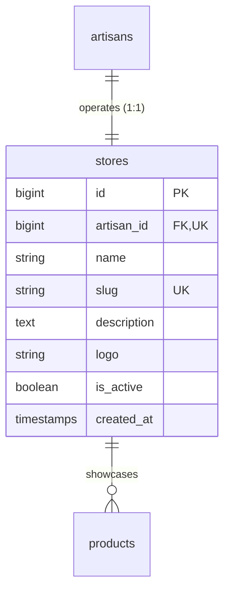

# Store Module

> Artisan merchant storefront profiles, unique merchant slug generation, public storefront browsing, and cloud media asset management (AWS S3 + CloudFront). Status: `stable`

---

## 1. Overview

The **Store Module** enables Moroccan artisans to establish and manage their digital identity on Lamsa.ma. It provides branded storefront pages, auto-resolving merchant slugs, store descriptions, and media upload handling.

- **Who Uses It:**
  - **Guests / Buyers:** Browse public artisan storefronts via `/api/v1/stores/{slug}` with verified active badges and live product counts.
  - **Artisans:** Create their exclusive storefront, upload/replace branding logos, update descriptions.
- **What It Does NOT Do:**
  - It does **not** manage the initial artisan identity registration or KYC review (handled by [`Modules/Auth`](../Auth/README.md)).
  - It does **not** manage individual product catalog items (handled by [`Modules/Product`](../Product/README.md)).

---

## 2. Quick Start

### Database Migrations
- `create_stores_table`

### Running Module Tests
```bash
php artisan test Modules/Store/tests/Feature
```

---

## 3. Architecture

### Key File Structure
```
Modules/Store/
├── app/
│   ├── Http/
│   │   ├── Controllers/
│   │   │   ├── ArtisanStoreApiController.php   # Store creation, profile edit, logo deletion
│   │   │   └── PublicStoreApiController.php    # Public storefront lookup by slug
│   │   ├── Requests/                           # StoreStoreRequest, UpdateStoreRequest
│   │   └── Resources/
│   │       └── StoreResource.php               # Resolves CDN logo_url, artisan bio, active products
│   ├── Models/
│   │   └── Store.php                           # HasOne Artisan, HasMany Products
│   ├── Policies/
│   │   └── StorePolicy.php                     # Ownership & one-store-per-artisan constraint
│   ├── Providers/
│   │   └── StoreModuleServiceProvider.php      # Route & policy registration
│   └── Services/
│       └── StoreService.php                    # Slug disambiguation, S3 media management
├── routes/
│   └── api.php
└── tests/
    └── Feature/
        ├── ArtisanStoreApiTest.php
        └── PublicStoreApiTest.php
```

### Dependencies on Other Modules
- `Modules/Auth`: Depends on `Artisan` model for ownership relationships.
- `Modules/Product`: Relates to `Product` models to display count of live catalog items.

### Design Decisions (Why, Not Just What)
- **One Store Per Artisan Invariant:** Enforced at both the database level (`unique(['artisan_id'])`) and policy level. An artisan cannot create multiple conflicting storefronts.
- **Cloud Media Disk Abstraction (`media_disk`):** In local development, logos are stored on the `public` disk. In production, setting `MEDIA_DISK=s3` uploads logos directly to AWS S3, and `StoreResource` resolves URLs through `https://cdn.lamsa.ma`.
- **Orphaned File Prevention:** Replacing or deleting a store logo automatically removes the old file from the storage disk (`Storage::disk($this->storageDisk())->delete($oldPath)`), preventing storage cost bloat.

---

## 4. Data Model



---

## 5. Core Flows

*(This is a straightforward CRUD and file upload module. No complex multi-actor asynchronous flows are present).*

---

## 6. API Reference

### Public Endpoints

| Method | Endpoint | Resource | Description |
| :--- | :--- | :--- | :--- |
| `GET` | `/api/v1/stores/{slug}` | `StoreResource` | View active artisan store with product count. Returns 404 for inactive or non-existent stores. |

### Artisan Endpoints (`auth:sanctum`, `role:artisan`)

| Method | Endpoint | Form Request | Policy Gate | Description |
| :--- | :--- | :--- | :--- | :--- |
| `GET` | `/api/v1/artisan/store` | None | `view` | Fetch authenticated artisan's store profile. |
| `POST` | `/api/v1/artisan/store` | `StoreStoreRequest` | `create` | Create storefront (name, description, logo). |
| `PUT/POST`| `/api/v1/artisan/store/update` | `UpdateStoreRequest` | `update` | Update details or replace logo image. |
| `DELETE`| `/api/v1/artisan/store/logo` | None | `update` | Remove existing store logo from storage. |

---

## 7. Events, Jobs & Commands

*N/A — Store lifecycle events are currently handled synchronously.*

---

## 8. Business Rules & Edge Cases

1. **Automatic Slug Collision Resolution:** If two artisans choose the name "Artisanat Fassi", [`StoreService`](app/Services/StoreService.php) automatically appends numerical suffixes (`artisanat-fassi`, `artisanat-fassi-1`, `artisanat-fassi-2`).
2. **PHP Multipart-PUT Workaround:** Because PHP does not natively parse multipart/form-data on HTTP `PUT` requests, `/artisan/store/update` supports both `POST` and `PUT` methods.
3. **Inactive Store Shielding:** Public queries strictly enforce `where('is_active', true)`. Inactive or suspended stores return `404 Not Found`.

---

## 9. Caching Strategy

- **Public Store Cache:** Public store responses contain `Cache-Control: public, max-age=3600, stale-while-revalidate=60`.
- **Artisan Management:** Authenticated artisan management endpoints return `Cache-Control: no-cache, private`.

---

## 10. Testing & Quality

```bash
# Run all Store feature tests
php artisan test Modules/Store/tests/Feature

# Inspect formatting
vendor/bin/pint --test Modules/Store
```

---

## 11. Known Limitations & Roadmap

- **Store Banner Covers:** Currently stores only support square logo avatars; wide panoramic banner images are planned for the upcoming storefront redesign.
- **Social Media Links:** Adding structured columns for Instagram, Facebook, and WhatsApp artisan contacts is on the roadmap.
