# Lamsa.ma (لمسة) — Artisan Marketplace & Live Auction Platform

> Modern, headless, modular REST API backend empowering Moroccan artisans to showcase authentic handcrafted creations and conduct live, competitive auctions.

[](https://github.com/ayoubelfaqir1-ops/Lamsa/actions)
[](https://php.net)
[](https://laravel.com)
[](docs/development/api-documentation.md)
[](#)

---

## 🏛️ High-Level System Architecture

Lamsa is engineered as a **Modular Monolith** where business logic is strictly encapsulated into domain modules. It uses a **stateless, API-first / headless design** paired with real-time WebSocket broadcasting and high-concurrency database row-locking.

```mermaid
flowchart TD
    subgraph Clients["Clients Layer"]
        Web["Next.js / React Web App"]
        Mobile["Flutter / React Native Mobile"]
    end

    subgraph Edge["Perimeter & Edge Layer"]
        CDN["Cloudflare CDN & DDoS Shield"]
        Nginx["Nginx Reverse Proxy (SSL / HTTP/2)"]
    end

    subgraph Backend["Application Server (PHP-FPM)"]
        direction TB
        AuthMod["Auth Module"]
        ProdMod["Product Module"]
        StoreMod["Store Module"]
        OrderMod["Order Module"]
        AuctionMod["Auction Module"]
        CMSMod["CMS Module"]
    end

    subgraph Infrastructure["State & Storage Services"]
        MySQL[("MySQL 8.0 (Primary DB)")]
        Redis[("Redis (Cache, Sessions, Queues)")]
        S3["AWS S3 / CloudFront (Media Storage)"]
        Reverb["Laravel Reverb (WebSockets)"]
    end

    Clients -->|HTTPS Requests| CDN
    CDN -->|Reverse Proxy| Nginx
    Nginx -->|FastCGI Socket| Backend
    Clients <-->|WSS Real-time Bids| Reverb

    Backend -->|Relational Data| MySQL
    Backend -->|Cache & Queue Jobs| Redis
    Backend -->|Broadcast Events| Reverb
    Backend -->|Store Logos & Product Images| S3
```



---

## 📖 Comprehensive Documentation Suite

For detailed technical guides, architecture deep dives, and operational playbooks, visit the [**Documentation Portal (`docs/`)**](docs/README.md):

| Guide | Target Audience | Primary Focus |
| :--- | :--- | :--- |
| [**Architecture Overview**](docs/architecture/overview.md) | Architects & Engineers | System topology, runtime execution, tech stack justifications. |
| [**Modular Monolith Architecture**](docs/architecture/modular-monolith.md) | Backend Developers | Encapsulation rules, folder conventions, inter-module communication. |
| [**Database Schema & Concurrency**](docs/architecture/database-schema.md) | DBAs & Backend Developers | Global ER diagram, composite indexes, pessimistic row locking (`lockForUpdate`). |
| [**Security & Access Control**](docs/architecture/security.md) | Security & Backend Devs | RBAC permission matrix, Sanctum tokens, rate limiting, trusted proxies. |
| [**Architecture Decision Records (ADRs)**](docs/architecture/decisions/0001-modular-monolith-over-microservices.md) | All Team Members | Historic decision logs (Why Modular Monolith, Why Pessimistic Locking, etc.). |
| [**Getting Started Guide**](docs/development/getting-started.md) | New Team Members | Local environment setup, dependencies, seeding, and verification. |
| [**Testing Strategy**](docs/development/testing-strategy.md) | QA & Developers | Feature vs Unit tests, SQLite vs MySQL, running and writing tests. |
| [**API Documentation (OpenAPI)**](docs/development/api-documentation.md) | Frontend & API Consumers | Accessing `/docs/api` explorer, OpenAPI 3.1 JSON export. |
| [**Frontend Integration Guide**](docs/development/frontend-integration.md) | Frontend & Mobile Engineers | Sanctum Bearer tokens, Reverb WebSockets, auto-generating TypeScript types. |
| [**Production Deployment**](docs/operations/production-checklist.md) | DevOps & SysAdmins | Ubuntu server provisioning, Nginx SSL, Supervisor daemons, cache warming. |
| [**Environment Variables Reference**](docs/operations/environment-variables.md) | DevOps & Developers | Exhaustive table of all configuration keys and allowed values. |
| [**Operational Runbooks**](docs/operations/troubleshooting.md) | On-Call Engineers | Incident response for queue failures, WebSocket drops, and cache issues. |

---

## 📦 Modular Domain Map

Each business domain maintains its own specialized 11-section documentation file inside its module directory:

| Module | Documentation Link | Status | Primary Responsibilities |
| :--- | :--- | :--- | :--- |
| **Auth** | [`Modules/Auth/README.md`](Modules/Auth/README.md) | `Stable` | Sanctum token lifecycle, RBAC (Buyer, Artisan, Admin), Google OAuth, signed verification emails. |
| **Product** | [`Modules/Product/README.md`](Modules/Product/README.md) | `Stable` | Catalog browsing, category tree, composite index search, reviews aggregation, favorites wishlist. |
| **Store** | [`Modules/Store/README.md`](Modules/Store/README.md) | `Stable` | Artisan store profiles, unique slug generation, S3 media uploads, store activation. |
| **Order** | [`Modules/Order/README.md`](Modules/Order/README.md) | `Stable` | Shopping cart sync, atomic checkout with row-locking, per-artisan sub-order splitting, fulfillment. |
| **Auction** | [`Modules/Auction/README.md`](Modules/Auction/README.md) | `Stable` | Scheduled/active competitive bidding, WebSocket broadcasts, pessimistic locking, auto-closing sweeper. |
| **CMS** | [`Modules/CMS/README.md`](Modules/CMS/README.md) | `Stable` | Headless editorial content (Terms, Privacy, FAQ), column projection, automated observer caching. |

---

## ⚡ Quick Start (4 Steps)

```bash
# 1. Install dependencies & configure environment
composer install && npm install
cp .env.example .env && php artisan key:generate

# 2. Run database migrations & seed demo data
php artisan migrate:fresh --seed && php artisan storage:link

# 3. Start API development server
php artisan serve

# 4. Verify the application
php artisan test       # Run 200+ internal Feature & Unit tests
npm run test:e2e       # Run automated Playwright API E2E journeys
```

The API will be live at: `http://127.0.0.1:8000/api/v1/health`  
Interactive OpenAPI documentation: `http://127.0.0.1:8000/docs/api`  
Visual E2E Test Report: `npm run test:e2e:report`

---

## 🛡️ Health Monitoring Endpoint

Production uptime probes and load balancers (e.g. AWS ALB, Uptime Kuma) monitor:
```http
GET /api/v1/health
```
Actively probes Database latency, Redis cache read/write, and AWS S3 storage availability, returning `200 OK` or `503 Service Unavailable`.
