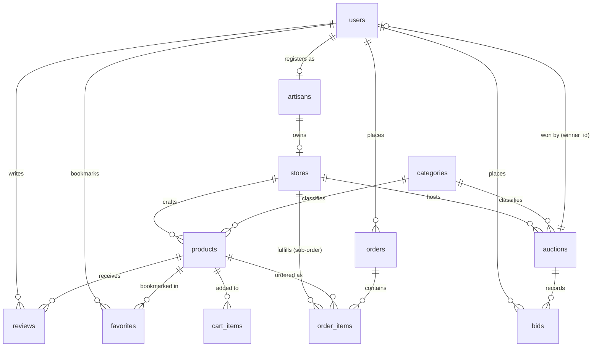

# Database Schema & Concurrency Design

> Comprehensive Entity-Relationship model, indexing strategies, and database-level concurrency controls for Lamsa.ma.

---

## 1. Global Entity-Relationship (ER) Diagram



---

## 2. Core Tables & Responsibilities

| Table Name | Owning Module | Key Columns & Foreign Keys | Notes |
| :--- | :--- | :--- | :--- |
| `users` | `Auth` | `id, name, email, password, role` | Core identity table. Roles: `buyer`, `artisan`, `admin`. |
| `artisans` | `Auth` | `id, user_id, bio, status, approved_at` | Artisan verification profile (`pending`, `active`, `suspended`). |
| `stores` | `Store` | `id, artisan_id, name, slug, logo, is_active` | Unique slug maintained automatically with collision counter. |
| `categories` | `Product` | `id, parent_id, name, slug, is_active` | Supports self-referential parent/child hierarchy. |
| `products` | `Product` | `id, store_id, category_id, name, slug, price, stock, status, is_published` | Main catalog entity. Supports soft deletes. |
| `reviews` | `Product` | `id, product_id, user_id, rating, comment` | Unique constraint on `(product_id, user_id)` prevents duplicate reviews. |
| `favorites` | `Product` | `id, product_id, user_id` | Wishlist items bookmarked by authenticated buyers. |
| `auctions` | `Auction` | `id, store_id, category_id, winner_id, title, starting_price, current_price, reserve_price, starts_at, ends_at, status` | Competitive bidding engine. Status: `draft`, `active`, `ended`, `cancelled`. |
| `bids` | `Auction` | `id, auction_id, user_id, amount, created_at` | Immutable log of bids placed on an auction. |
| `orders` | `Order` | `id, user_id, total_amount, status, payment_status, shipping_address` | Master order record placed by a buyer. |
| `order_items` | `Order` | `id, order_id, product_id, artisan_id, unit_price, quantity, status` | Sub-order split items fulfilled independently by each artisan. |
| `pages` | `CMS` | `id, title, slug, content, is_published` | Editorial content (Terms of Service, Privacy Policy, FAQ). |

---

## 3. High-Performance Indexing Strategy

To guarantee sub-50ms API responses under production load, the database schema implements strategic indexes:

### A. Catalog Filtering & Full-Text Search
```sql
-- Compound index on products for fast catalog queries
INDEX idx_products_catalog (is_published, status, category_id, price);

-- Full-text index for product keyword searches
FULLTEXT INDEX idx_products_search (name, description);
```

### B. High-Frequency Bidding & Highest Bid Retrieval
```sql
-- Composite index for instant highest-bid lookups
INDEX idx_bids_auction_amount (auction_id, amount DESC);
```

### C. Unique Slug Lookups
```sql
UNIQUE INDEX uidx_stores_slug (slug);
UNIQUE INDEX uidx_products_slug (slug);
UNIQUE INDEX uidx_pages_slug (slug);
```

---

## 4. Database Concurrency & Race-Condition Prevention

**Concept: Pessimistic Row Locking (`SELECT ... FOR UPDATE`)**
> When multiple requests attempt to modify the same database row simultaneously, an optimistic approach might cause inconsistent states. **Pessimistic Locking** places an exclusive lock on the specific database row inside an active InnoDB transaction, forcing all competing requests to wait in line until the lock is released.

Lamsa.ma enforces pessimistic locking in two mission-critical workflows:

### 1. Atomic Order Checkout ([`CheckoutService.php`](file:///c:/laragon/www/Lamsa.ma/Modules/Order/app/Services/CheckoutService.php))
When 2 buyers attempt to buy the last handcrafted rug in stock at the exact same millisecond:
```php
DB::transaction(function () use ($cart) {
    // Lock product rows against concurrent checkout attempts
    $products = Product::whereIn('id', $cartItemIds)
        ->lockForUpdate()
        ->get();

    foreach ($cart->items as $item) {
        $product = $products->find($item->product_id);

        if ($product->stock < $item->quantity) {
            throw new InsufficientStockException("Item out of stock: {$product->name}");
        }

        // Safely decrement stock
        $product->decrement('stock', $item->quantity);
    }
});
```

### 2. Live Auction Bidding ([`AuctionService.php`](file:///c:/laragon/www/Lamsa.ma/Modules/Auction/app/Services/AuctionService.php))
When 5 buyers simultaneously place higher bids on an antique ceramic piece:
```php
DB::transaction(function () use ($auctionId, $bidAmount, $userId) {
    // Exclusively lock the auction row during validation and update
    $auction = Auction::where('id', $auctionId)
        ->lockForUpdate()
        ->firstOrFail();

    if ($bidAmount <= $auction->current_price) {
        throw new InvalidBidException("Bid must be strictly greater than current price.");
    }

    $auction->update(['current_price' => $bidAmount]);

    Bid::create([
        'auction_id' => $auction->id,
        'user_id'    => $userId,
        'amount'     => $bidAmount,
    ]);
});
```
This guarantees that **no two bids can ever record the same price**, and underbids arriving milliseconds apart are reliably rejected.

