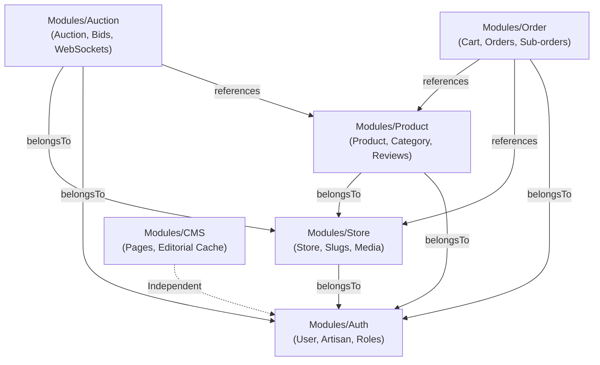

# Modular Monolith Architecture

> Architectural rules, folder conventions, boundary enforcement, and inter-module communication protocols in Lamsa.ma.

---

## 1. Why a Modular Monolith?

**Concept: Modular Monolith**
> A software design approach where a single codebase is partitioned into distinct, independently encapsulated business domains (modules). It provides the strict boundary separation and maintainability of microservices without the operational overhead of network serialization, distributed transactions, or multi-repo chaos.

In Lamsa.ma, we use the `nwidart/laravel-modules` package to partition our e-commerce platform into 6 domain modules under `Modules/`:

```
Lamsa.ma/
├── app/                  # Host infrastructure (Base Controller, HealthCheck, Global Middleware)
├── config/               # Global configuration (filesystems, cache, database)
├── bootstrap/            # Application bootstrap & routing registration
└── Modules/              # Business Domains
    ├── Auth/             # Identity, Sanctum, Roles, OAuth
    ├── Store/            # Artisan stores, logos, slug resolution
    ├── Product/          # Product catalog, categories, reviews, favorites
    ├── Order/            # Cart management, checkout, multi-vendor order splitting
    ├── Auction/          # Live auctions, proxy bids, Reverb broadcasting, closing sweeper
    └── CMS/              # Editorial pages, terms, privacy policy, public cache
```

---

## 2. Standard Module Internal Directory Layout

Every module adheres to the exact same predictable 11-part anatomy:

```
Modules/<Domain>/
├── app/
│   ├── Enums/            # Domain-specific typed PHP enums (e.g. OrderStatus, ProductStatus)
│   ├── Events/           # Dispatched domain events (e.g. BidPlaced, ArtisanApproved)
│   ├── Http/
│   │   ├── Controllers/  # REST API endpoints returning JsonResponse / JsonResource
│   │   ├── Requests/     # FormRequest validation rules (e.g. ProductCatalogRequest)
│   │   └── Resources/    # API serialization resources (e.g. StoreResource, OrderResource)
│   ├── Models/           # Eloquent entities with relationships and query scopes
│   ├── Observers/        # Model lifecycle listeners for automated cache invalidation
│   ├── Policies/         # Authorization gates (e.g. canUpdate, canBid)
│   ├── Providers/        # ServiceProvider registering routes, migrations, and observers
│   └── Services/         # Pure domain business logic & transactions
├── config/               # Optional module-specific overrides
├── database/
│   ├── factories/        # Model factories for testing
│   ├── migrations/       # Domain database schema tables
│   └── seeders/          # Domain demo and default data
├── routes/
│   └── api.php           # Domain API routes prefixed with /api/v1/<domain>
├── tests/
│   ├── Feature/          # Subcutaneous HTTP tests with RefreshDatabase
│   └── Unit/             # Pure PHP calculation & service tests
└── README.md             # Standardized 11-section module documentation
```

---

## 3. Dependency & Interaction Rules

To avoid circular dependencies and tight coupling (spaghetti code), modules follow strict rules of engagement:



### The 4 Golden Rules:

1. **Downstream Dependencies Only**:
   - `Auth` is foundational. It knows about Users and Artisans, but knows *nothing* about Orders, Auctions, or Carts.
   - `Product` depends on `Store` (every product belongs to an artisan store).
   - `Order` and `Auction` depend on `Product` and `Store`.
2. **Encapsulate Validation Inside the Module**:
   - Form Requests must live inside `Modules/<Domain>/app/Http/Requests/`. Never place module validation rules in root `app/Http/Requests`.
3. **Database Migration Isolation**:
   - Each module owns its migrations in `Modules/<Domain>/database/migrations/`. 
   - A module must **never** modify another module’s tables directly via alter migrations unless explicitly coordinated as a foreign key constraint.
4. **Prefer Event-Driven Communication for Cross-Cutting Side Effects**:
   - When an event in Domain A needs to trigger behavior in Domain B, use **Domain Events**.
   - *Example*: When `Modules/Auth` approves an artisan, it dispatches `ArtisanApproved`. Any module interested in this event listens to it asynchronously, without `Auth` needing hardcoded calls to other modules.

