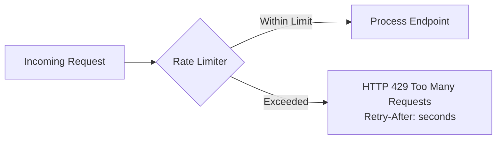

# Security & Access Control Architecture

> Security perimeter, authentication lifecycle, Role-Based Access Control (RBAC) matrix, and API protection mechanisms in Lamsa.ma.

---

## 1. Authentication Lifecycle (Laravel Sanctum)

Lamsa.ma uses **Laravel Sanctum** for issuing stateful API tokens to SPA web frontends and mobile clients:

- **Token Format**: Bearer Personal Access Tokens (`Authorization: Bearer 1|abcdef...`).
- **Storage**: Plaintext tokens are returned **only once** upon registration or login. The database stores only a SHA-256 hash of the token (`personal_access_tokens.token`).
- **Revocation**:
  - Logout single device: `$user->currentAccessToken()->delete()`
  - Logout all devices (security reset): `$user->tokens()->delete()`

---

## 2. Role-Based Access Control (RBAC) Matrix

Users belong to one of three roles: `buyer`, `artisan`, or `admin`.

| Endpoint Domain | Guest (Unauthenticated) | Authenticated Buyer | Pending Artisan | Approved Artisan | Platform Admin |
| :--- | :---: | :---: | :---: | :---: | :---: |
| **Browse Catalog & Stores** |  Allow |  Allow |  Allow |  Allow |  Allow |
| **Manage Cart & Wishlist** | ❌ 401 |  Allow |  Allow |  Allow |  Allow |
| **Place Bids in Auctions** | ❌ 401 |  Allow |  Allow | ⚠️ Cannot bid on own auction |  Allow |
| **Checkout & Pay** | ❌ 401 |  Allow |  Allow |  Allow |  Allow |
| **Write Product Review** | ❌ 401 |  Allow (if verified) |  Allow | ⚠️ Cannot review own product |  Allow |
| **Create / Edit Store** | ❌ 401 | ❌ 403 | ❌ 403 (Pending) |  Allow |  Allow |
| **Publish Products & Auctions** | ❌ 401 | ❌ 403 | ❌ 403 (Pending) |  Allow |  Allow |
| **Fulfill Orders (Sub-orders)** | ❌ 401 | ❌ 403 | ❌ 403 |  Allow (Own items) |  Allow |
| **Approve / Reject Artisans** | ❌ 401 | ❌ 403 | ❌ 403 | ❌ 403 |  Allow |
| **Manage CMS Pages** | ❌ 401 | ❌ 403 | ❌ 403 | ❌ 403 |  Allow |

---

## 3. Rate-Limiting & Anti-Brute-Force Policies

To protect against credential stuffing, DoS, and bot scraping, rate limiters are enforced via Laravel middleware:



1. **Authentication Endpoints (`/api/v1/auth/*`)**:
   - `throttle:60,1`: Maximum 60 requests per minute per IP address.
   - Login failures track failed attempts and enforce progressive delays.
2. **Public API Endpoints (`/api/v1/products`, `/api/v1/categories`)**:
   - `throttle:120,1`: Maximum 120 requests per minute for unauthenticated public browsing.
3. **Auction Bidding (`/api/v1/auctions/{id}/bids`)**:
   - High-throughput sliding window per authenticated user ID to prevent bot spam while allowing competitive real-time bidding.

---

## 4. Reverse Proxy & Trusted Proxies Defense

**Concept: Reverse Proxy IP Spoofing**
> When your application sits behind a CDN (like Cloudflare) or load balancer (Nginx), all incoming TCP connections originate from the proxy's IP address. If the application does not explicitly trust the proxy, attackers can spoof the `X-Forwarded-For` header to bypass rate limits or evade IP bans.

In `bootstrap/app.php`, Lamsa configures trusted proxies:
```php
$middleware->trustProxies(at: '*');
```
This guarantees that:
- `$request->ip()` always resolves to the **real client IP address**, ensuring accurate rate-limiting per user rather than blocking the entire CDN.
- Generated absolute links and redirects correctly use HTTPS (`X-Forwarded-Proto`).

---

## 5. Sensitive Data & Transport Security

1. **Password Hashing**: Passwords are encrypted using **Argon2id** (or Bcrypt with a work factor of 12).
2. **Signed URLs**: Email verification and password reset links use HMAC-SHA256 time-limited signatures (`URL::temporarySignedRoute()`).
3. **HTTP Security Headers**: Enforced at the Nginx reverse-proxy layer:
   - `Strict-Transport-Security: max-age=31536000; includeSubDomains` (HSTS)
   - `X-Frame-Options: DENY` (Clickjacking prevention)
   - `X-Content-Type-Options: nosniff` (MIME-sniffing prevention)
   - `Referrer-Policy: strict-origin-when-cross-origin`

