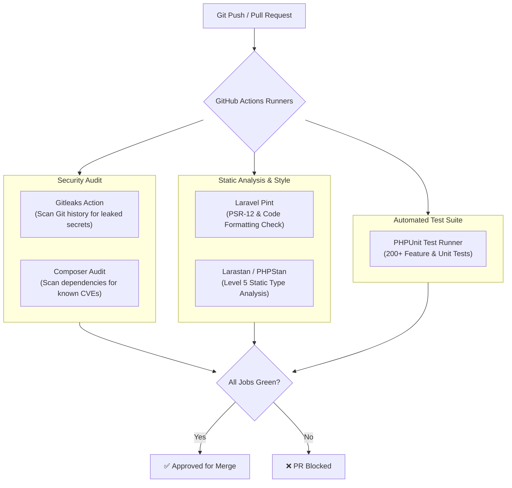

# CI/CD Pipeline & Automated Quality Gates

> Architecture of the GitHub Actions continuous integration and continuous deployment pipelines for Lamsa.ma.

---

## 1. CI Workflow Overview (`.github/workflows/ci.yml`)

Every pull request and push to any branch triggers the automated CI pipeline. No code can be merged into `main` without passing all three quality gates in parallel:



---

## 2. The 3 Quality Gates Explained

### Gate 1: Security Audit (`security-audit`)
- **Gitleaks (`gitleaks/gitleaks-action`)**: Inspects every commit in the PR for accidental hardcoded credentials (AWS keys, database passwords, private Reverb secrets).
- **Composer Audit (`composer audit`)**: Checks all locked package versions in `composer.lock` against the official Packagist Security Advisory Database to catch vulnerable dependencies.

### Gate 2: Static Analysis (`static-analysis`)
- **Pint (`vendor/bin/pint --test`)**: Verifies that every modified file strictly complies with PSR-12 and Laravel syntax rules without any manual nitpicking in code reviews.
- **Larastan (`vendor/bin/phpstan analyse --memory-limit=2G`)**: Validates PHP type declarations, ensures models do not access non-existent properties, and prevents fatal null-pointer exceptions at compile time.

### Gate 3: Automated Tests (`tests`)
- Configured with environment overrides:
  ```yaml
  APP_ENV: testing
  DB_CONNECTION: sqlite
  DB_DATABASE: ':memory:'
  CACHE_STORE: array
  QUEUE_CONNECTION: sync
  ```
- Executes all 201 automated tests across all 6 domain modules in ~45 seconds.

---

## 3. Pre-Deploy Gate Architecture (MySQL 8.0)

For production deployment, Lamsa utilizes a **Tiered Testing Architecture**:

```
[Developer Working on feature/*]
        │
        ▼ (Fast Feedback ~45s)
   [SQLite in-memory CI]
        │
        ▼ (PR Merged into main)
   [Deploy Pipeline (deploy.yml)]
        │
        ▼ (Pre-Flight Gate ~1m 30s)
   [Real MySQL 8.0 Docker Service Container]
        │  Runs 200+ tests against real InnoDB engine
        │
        ▼ (Passes)
   [Zero-Downtime Deployment to Server]
```

### Why run MySQL in the deployment pipeline?
1. Validates strict SQL modes (`ONLY_FULL_GROUP_BY`).
2. Tests real InnoDB pessimistic locking (`SELECT ... FOR UPDATE`).
3. Catches MySQL-specific index length or collation issues before touching the live server.

